# 人工智能社官网 · NEXUS

> 这是一个**独立新建的视觉增强版前端**，位于 `ai-club-nova/`。它不修改仓库中现有 `frontend/` 的任何文件，并继续对接同一套 Spring Boot 后端与 `/api` 接口。路由、页面、管理流程、权限与校验行为与原前端保持一致；师生风采在此基础上重构为专用人物栏目。

现有前端是偏编辑设计的绿色 / 米白风格；NEXUS 版本把它重做为深空星云 + 极光青紫的科技视觉，但功能不缩水：

- 现在共 15 条路由（含 404），新增 `/admin/people/:id` 人物专用编辑器。
- 同样的列表筛选、分页、详情、图片放大、预览、发布、下架、回收站、账号管理、操作记录。
- 师生风采人物固定为姓名、类别、职务方向、相关图片、简介五个字段。
- 保留 Element Plus 后台组件与 wangEditor 正文编辑器。

> 下方截图使用测试期间写入 H2 内存库的**临时示例数据**，仅用于展示界面状态，不代表社团真实新闻、成员、项目或成果。正式内容以后台发布为准。

## 预览

| 首页 Hero | 首页长图 |
| --- | --- |
|  | 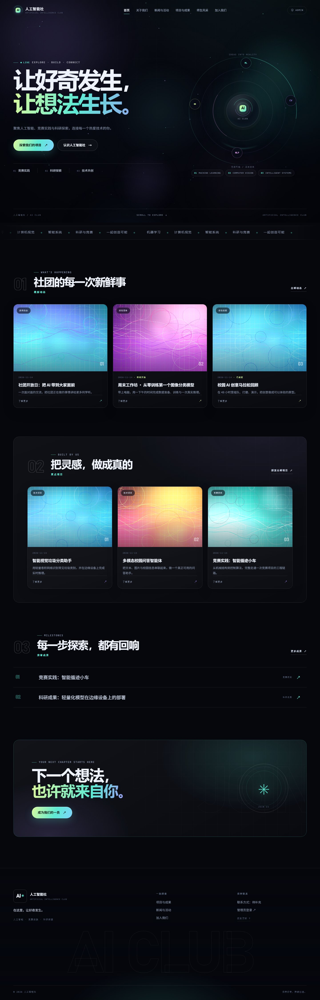 |

| 新闻与活动 | 内容详情 |
| --- | --- |
|  |  |

| 内容管理首页 | 编辑页面 A |
| --- | --- |
|  | 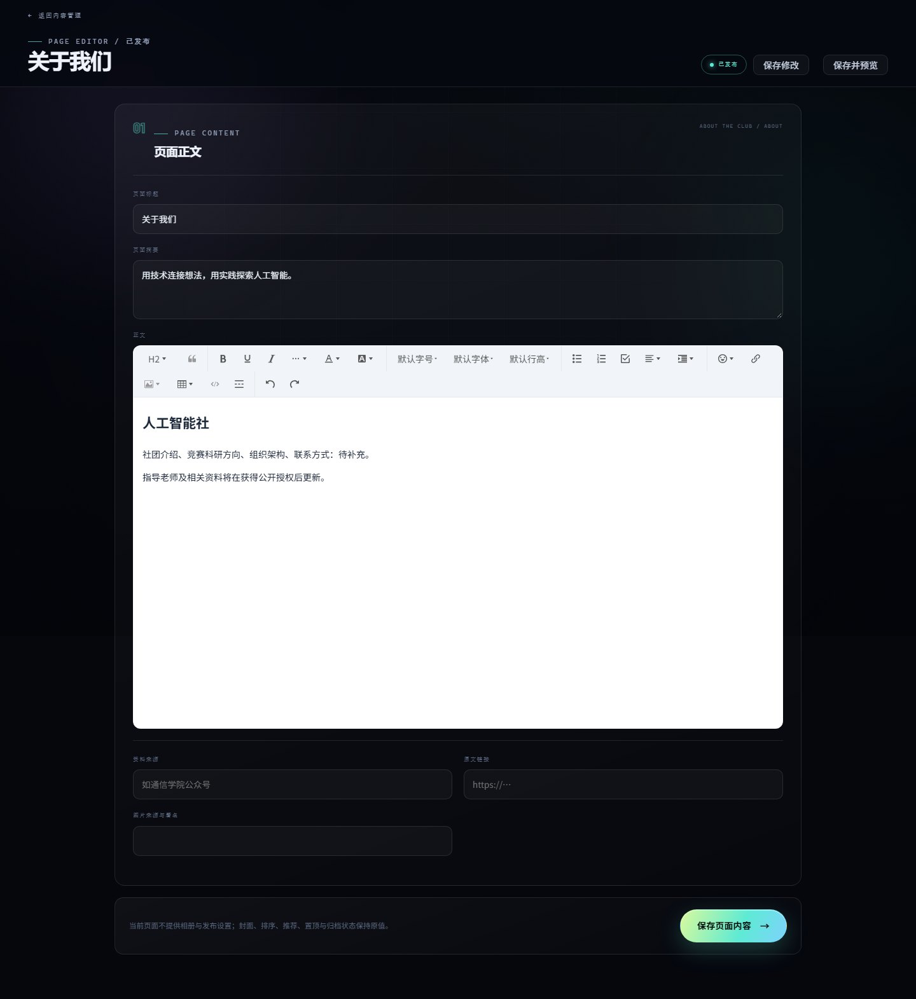 |

| 栏目管理（页面 B） | 条目编辑器 |
| --- | --- |
| 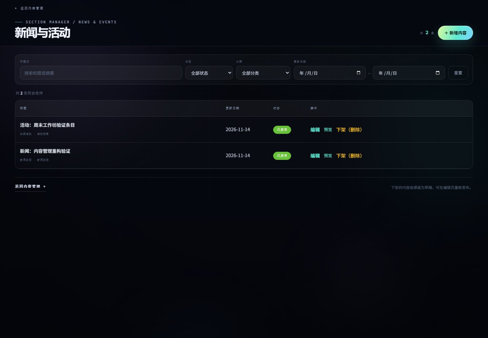 | 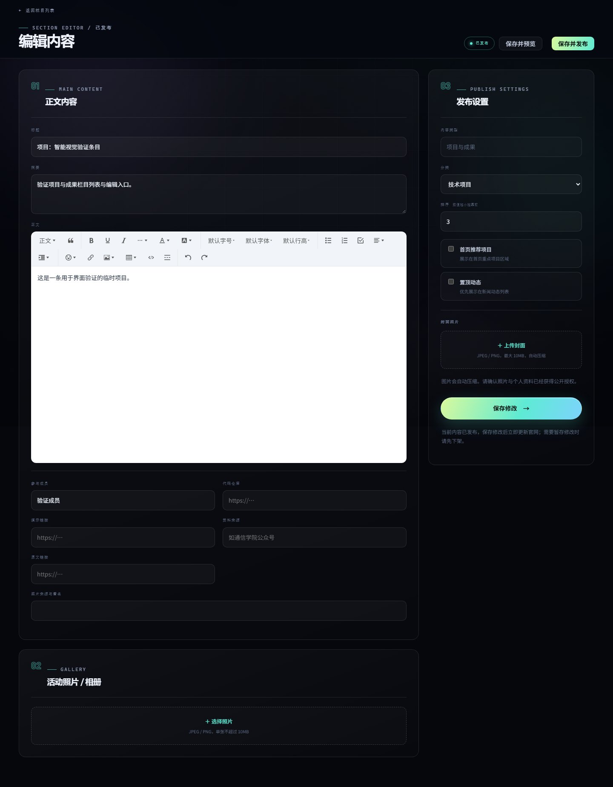 |

| 页头品牌标识 | 页脚品牌与学院标识 |
| --- | --- |
| 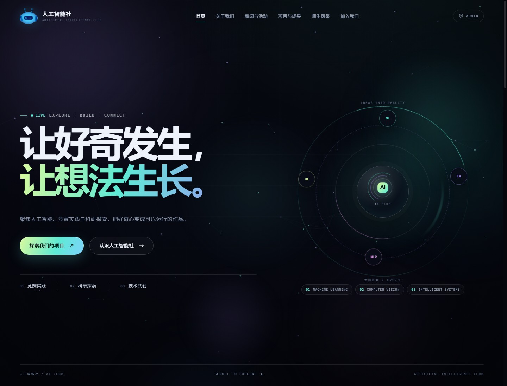 | 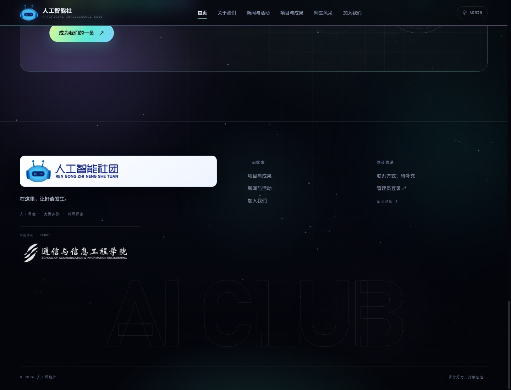 |

| 师生风采列表 | 人物详情 |
| --- | --- |
| 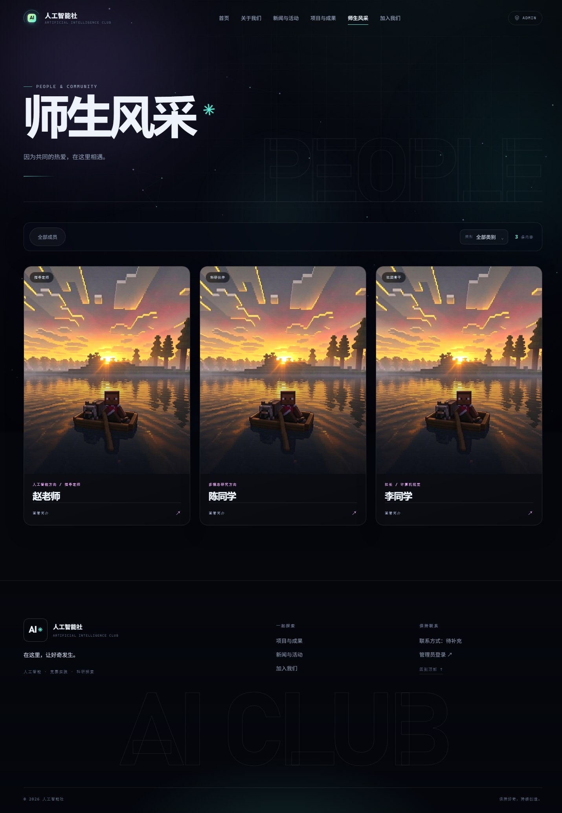 | 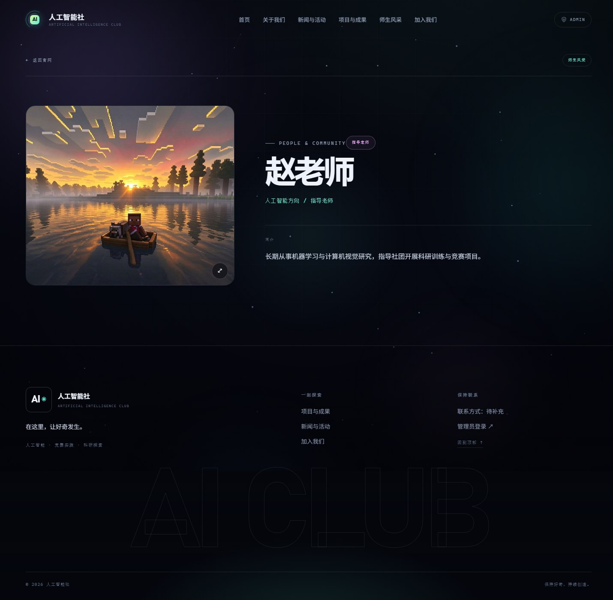 |

| 师生风采管理 | 人物编辑器 |
| --- | --- |
| 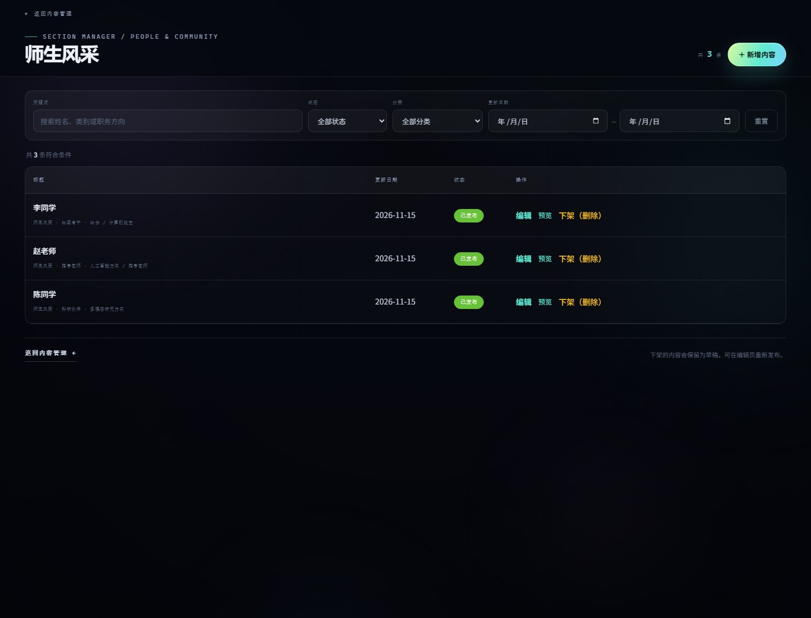 | 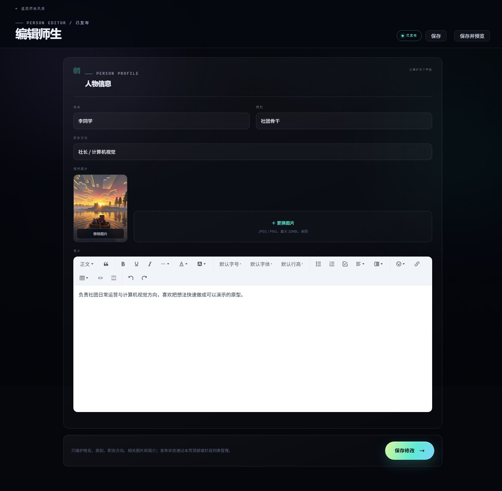 |

| 移动端人物列表 | 移动端人物编辑器 |
| --- | --- |
| 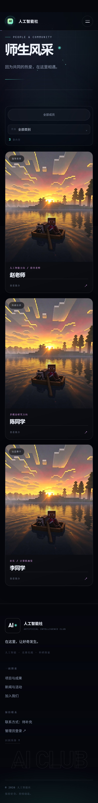 | 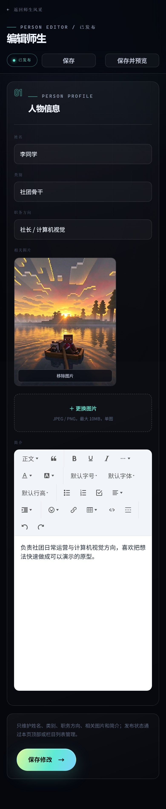 |

| 移动端栏目管理 | 移动端内容管理 |
| --- | --- |
| 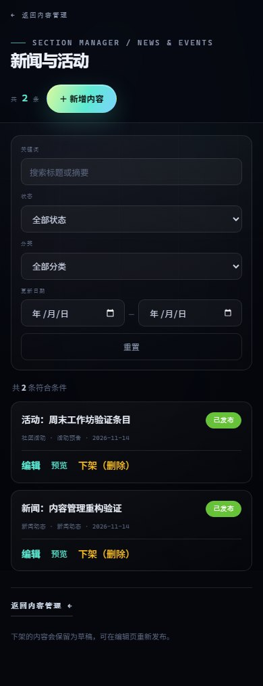 | 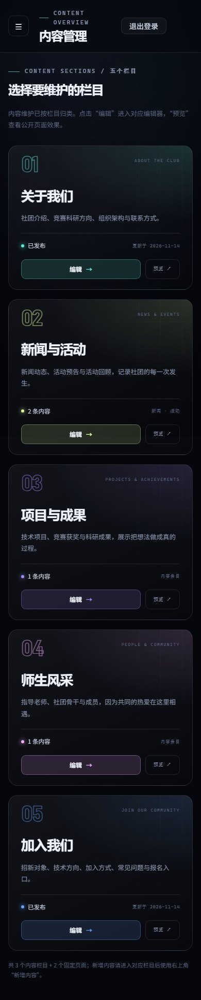 |

| 管理员登录 | 移动端菜单 |
| --- | --- |
| 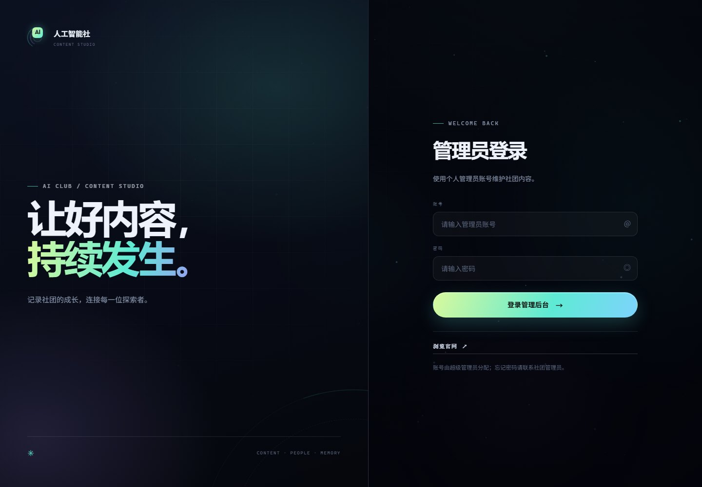 | 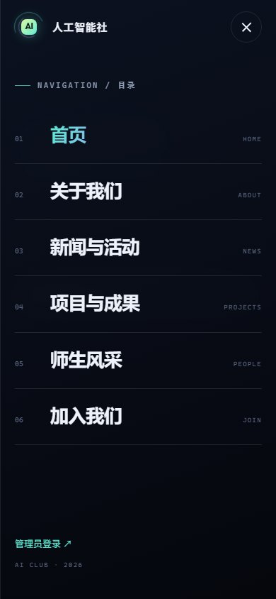 |

更多截图见 [`screenshots/`](screenshots)。

## 技术栈

与现有前端保持一致，不引入额外运行时框架：

| 类别 | 选型 |
| --- | --- |
| 框架 | Vue 3.5 + TypeScript |
| 构建 | Vite 7 |
| 路由 | Vue Router 4 |
| 状态 | Pinia 3 |
| 请求 | Axios 1 |
| 后台组件 | Element Plus 2（深色主题变量覆盖） |
| 富文本 | wangEditor 5 |
| 样式 | 原生 CSS + 设计令牌 + 关键帧 / IntersectionObserver |

## 快速开始

### 1. 启动现有后端（二选一）

**本地界面预览（H2 内存库，不写生产数据）**

```powershell
cd backend
mvn spring-boot:test-run -Dspring-boot.run.main-class=cn.aiclub.PreviewApplication
```

临时账号：`test-super` / `a-test-password-12345`。该账号与 H2 仅用于测试，后端退出后数据清空。

**正式运行**

按现有后端文档配置 MySQL、`BOOTSTRAP_USER`、`BOOTSTRAP_PASSWORD` 等环境变量后启动，监听 `8080`。

### 2. 启动本项目

```powershell
cd ai-club-nova
npm install
npm run dev
```

打开 <http://localhost:5174>。开发服务器把 `/api` 代理到 `http://localhost:8080`；如果后端地址不同，修改 [`vite.config.ts`](vite.config.ts) 中的 `backend` 常量即可。

### 3. 生产构建

```powershell
npm run build
npm run preview   # 本地检查 dist 与 /api 代理
```

`dist/` 可由 Nginx 托管，保持与现有部署相同的两条规则即可：

1. `/api` 反向代理到 Spring Boot；
2. 其余路径回退到 `index.html`，保证 `/contents/:id` 等地址刷新可直接访问。

## 功能对齐

### 公开官网

| 路由 | 功能 |
| --- | --- |
| `/` | 首页 Hero、精选图片 / 轨道视觉、首页推荐动态、重点项目、首页推荐荣誉、加入入口；仅展示勾选“首页推荐”的已发布内容，接口失败可重试 |
| `/about` | 固定页面 `about`：标题、摘要、封面、富文本正文 |
| `/join` | 固定页面 `join`：正文、封面、`joinUrl` 外部报名按钮 |
| `/news` | 新闻 / 活动列表：类型切换、分类筛选、计数、12 条 / 页分页 |
| `/projects` | 项目与成果列表：分类筛选、计数、分页 |
| `/people` | 师生风采列表：人物卡片只展示姓名、类别、图片、职务方向；类别筛选来自已发布人物 |
| `/contents/:id` | 详情：人物详情展示姓名、类别、职务方向、相关图片、简介；其他内容保留活动时间 / 地点 / 状态、成员信息、封面、正文、相册、图片来源、仓库 / 演示 / 原文链接、图片放大 |
| `/login` | 管理员登录、错误提示、登录后跳转；含“浏览官网”入口 |
| 其他 | 404 页面 |

### 管理后台

| 路由 | 功能 |
| --- | --- |
| `/admin` | 五个固定栏目卡片：关于我们、新闻与活动、项目与成果、师生风采、加入我们；每个栏目提供编辑与预览，不再提供全局新建和栏目级下架 |
| `/admin/pages/:key` | 编辑页面 A（`about` / `join`）：标题、摘要、wangEditor 正文、资料来源 / 原文链接 / 署名 / 报名链接；不提供相册、封面和发布设置，保存时保留原有封面、推荐等字段 |
| `/admin/section/:section` | 编辑页面 B（`news` / `projects` / `people`）：列出全部条目，支持关键词、状态、分类、上传时间查询；置顶优先、其余按上传时间倒序；右上角新增；行内编辑 / 预览 / 下架（转草稿） / 草稿发布；人物栏目使用专用人物编辑器 |
| `/admin/people/:id` | 人物编辑器：仅维护姓名、类别、职务方向、相关图片、简介五个字段；支持保存、保存并预览、发布；不提供摘要、类型、排序、推荐、置顶、归档、相册和发布设置 |
| `/admin/edit/:id` | 条目编辑器：标题、摘要、wangEditor 正文、分类、首页推荐、置顶、按届别归档、封面、相册、活动 / 项目 / 成员扩展字段、保存、保存并预览、保存并发布、离开未保存提醒；人物会自动跳转到专用编辑器 |
| `/admin/edit/new?section=...` | 从 B 栏目新增条目，按栏目限定内容类型 |
| `/admin/preview/:id` | 管理员草稿 / 已发布内容预览，显示预览提示 |
| `/admin`（操作记录） | 操作人、操作、对象、时间分页表格 |
| `/admin`（账号管理，超级管理员） | 账号列表、创建账号、启用 / 停用、调整角色、重置密码 |

### 接口契约

继续使用现有后端的接口；本次只新增一个公开类别接口，并为人物内容增加 `person_role` 存储：

```text
GET  /api/public/pages/{key}
GET  /api/public/contents
GET  /api/public/contents/{id}
GET  /api/public/people/categories
GET  /api/media/{id}
GET  /api/auth/csrf
POST /api/auth/login
GET  /api/auth/me
POST /api/auth/logout
POST /api/auth/password
GET  /api/admin/contents
GET  /api/admin/contents/{id}
POST /api/admin/contents
PUT  /api/admin/contents/{id}
POST /api/admin/contents/{id}/{publish|unpublish|trash|restore}
POST /api/admin/media
GET  /api/admin/accounts
POST /api/admin/accounts
PUT  /api/admin/accounts/{id}
POST /api/admin/accounts/{id}/password
GET  /api/admin/audit
```

请求体、版本号并发校验、CSRF、Cookie 会话、上传大小与格式限制全部沿用原实现。

## 视觉与交互亮点

- **品牌标识**：页头使用社团机器人标识；页脚浅色品牌牌展示社团完整字标，并展示通信与信息工程学院字标；资源位于 `public/brand/`。
- **深空星云背景**：多层极光色场、网格、噪点与暗角叠加，固定视差层不干扰阅读。
- **神经粒子场**：Canvas 绘制粒子与连线，跟随鼠标产生连接反馈；低性能 / 减少动效环境自动降级。
- **轨道主视觉**：封面图存在时切换为发光画框，没有封面时显示三层轨道、节点与核心标识。
- **滚动叙事**：`IntersectionObserver` 驱动的淡入 / 位移 / 模糊消散；顶部滚动进度线与详情阅读进度线。
- **3D 卡片**：鼠标跟随的轻微 tilt、径向高光、图片缩放与渐变描边；触屏自动关闭 tilt。
- **图片查看器**：封面临场、相册缩略图、左右方向键、ESC、双击放大，正文图片点击放大。
- **管理后台**：独立玻璃质感工作台、五栏目内容卡片、深色 Element Plus 表格 / 下拉 / 弹窗、渐变主按钮、移动端抽屉侧栏与移动端条目卡片。
- **小屏适配**：`1100 / 900 / 760 / 460` 四档断点；移动端全屏导航、单列卡片、栏目内容使用卡片而不是横向裁切的表格。
- **可访问性**：跳转到主要内容、清晰焦点环、按钮 `aria` 状态、图片 alt、键盘操作、`prefers-reduced-motion` 降级。
- **不依赖外部字体 CDN**：使用 Bahnschrift / Avenir Next / 微软雅黑 / 苹方等系统字体栈，离线与国内网络环境不会阻塞首屏。

## 目录结构

```text
ai-club-nova/
├── public/
│   ├── brand/                # 社团机器人标识、完整字标、学院字标
│   └── favicon.svg
├── screenshots/              # 视觉预览截图（示例数据）
├── src/
│   ├── api.ts                # Axios 实例、CSRF、类型与展示辅助
│   ├── main.ts               # 应用入口、Element Plus 深色主题、全局指令
│   ├── router.ts             # 路由与管理员守卫
│   ├── sections.ts           # 五个内容栏目的统一配置
│   ├── App.vue               # 全局背景、页面过渡、公共页头尾
│   ├── components/           # 卡片、页头、页脚、灯箱、栏目卡片、后台表格等
│   ├── directives/motion.ts  # v-reveal / v-tilt
│   ├── stores/auth.ts        # Pinia 登录状态
│   ├── styles/               # base / public / admin 三套样式
│   └── views/                # 首页、列表、详情、静态页、登录、后台、页面A/B、编辑器、404
├── index.html
├── package.json
├── tsconfig.json
└── vite.config.ts
```

## 设计令牌

```css
--nx-bg: #05070d;        /* 深空底色 */
--nx-text: #eef3fb;      /* 主文字 */
--nx-muted: #8d9ab2;     /* 次文字 */
--nx-cyan: #5eead4;      /* 极光青 */
--nx-violet: #a78bfa;    /* 极光紫 */
--nx-lime: #d9f99d;      /* 荧光绿 */
--nx-grad: linear-gradient(112deg, #5eead4, #a78bfa 52%, #f0abfc);
```

字体：`Bahnschrift / DIN Alternate / Avenir Next / Segoe UI` 用于标题，`Noto Sans SC / 微软雅黑 / 苹方` 用于中文正文，`Cascadia Code / Consolas` 用于编号与标签。

## 验证记录

在 Windows + Node 24 + Chrome Headless 环境下完成：

- `npm run build`：`vue-tsc -b` 类型检查通过，Vite 生产构建通过。
- 真实浏览器（Chrome DevTools Protocol）逐项验证通过：
  - 内容管理首页显示五个栏目，无全局“新建内容”，无栏目级“下架”；
  - 编辑页面 A：标题、摘要、正文可编辑；页面中没有相册、封面和发布设置；保存成功；关于我们与加入我们均可进入；
  - 编辑页面 B：新闻与活动列表同时显示新闻和活动；关键词筛选生效；下架后变为草稿；草稿可重新发布；右上角新增内容可创建并发布；
  - 项目与成果、师生风采栏目列表与新增入口正常；已有项目编辑器类型固定、返回对应栏目；
  - 师生风采列表仅显示姓名、类别、图片、职务方向；详情显示简介；公开类别筛选生效；
  - 人物编辑器只有五个字段，隐藏字段保存后保持不变；旧 `/admin/edit/:id` 人物地址会跳转到专用编辑器；
  - 旧的 `/admin/edit/:id` 页面编辑地址会自动跳转到页面 A；
  - 操作记录、账号管理仍可正常访问；
  - 390 × 844 下内容管理、栏目管理、页面 A 均无横向溢出，栏目列表改为移动端卡片。
- 截图核对桌面 `1440 × 1000` / `1440 × 1400` 与移动端 `390 × 844` 布局。

## 说明

- 本目录主要包含前端；师生风采重构同时修改了仓库现有后端，并新增数据库迁移 `V3__person_role.sql`。
- 仓库原有 `frontend/` 未做修改；`backend/` 仅增加人物职务方向字段、人物校验与公开类别接口。
- 截图中的人物 / 活动 / 项目均为界面测试用示例数据，请勿当作社团真实资料引用。
- 生产环境请替换 `vite.config.ts` 中的后端地址或在 Nginx 层代理 `/api`，并继续使用现有部署的 HTTPS / Cookie / 上传安全配置。
